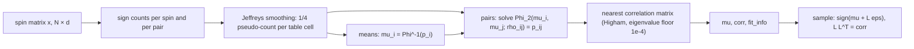

# Baselines: moment-matched models of spins

You have a sample of binary data (rows of spins in $\{-1,+1\}^{dim}$ from a QPU, a Boltzmann
machine, an autoencoder's codes) and a generative model you would like to credit with having
learned its structure. A kernel score (a distance between two samples' distributions built from
a kernel, [`dwave.plugins.torch.evaluation`](evaluation.md)) measures how far the model's
samples sit from the data, but a distance alone cannot say how much of the structure it
reproduces was *cheap*: the per-spin means and the pairwise correlations of any sample can be
matched by a classical model that knows nothing else, and a model that only matches them looks
impressive when read against the uniform distribution. How much of the data's measured structure
survives once means and pairwise correlations are accounted for? The module
`dwave.plugins.torch.models.baselines` supplies the three baselines that answer the question,
weakest first: fair coins, independent per-spin means, and the **dichotomized Gaussian**, the
signs of a latent multivariate normal, which matches the sample's per-spin means and pairwise
spin correlations exactly (up to a smoothing of order $1/N$, below), at any margins, whenever a
member of the family can. All three sit behind one `fit(x)` / `sample(n, generator=None)`
interface and are `torch.nn.Module`s, so `.to(device)`, `state_dict` and `load_state_dict`
apply. A candidate model's score is then read against the strongest cheap baseline instead of
against noise: whatever the dichotomized Gaussian already captures, the candidate cannot claim
as learned.

## Quickstart

```python
import torch
from dwave.plugins.torch.evaluation import Evaluator
from dwave.plugins.torch.models import BASELINES, DichotomizedGaussian

# x_train, x_val, x_test: floating spin matrices in {-1, +1}, shape (rows, dim), one dim
dim = x_train.shape[1]
evaluator = Evaluator(x_train, x_val, x_test, block_size=1024)
data, data_se = evaluator.uniform_score("test")   # data vs uniform: [0] the evaluator's headline
                                                  # kernel (its summary over all orders), [k] the
                                                  # interaction order k (k-spin parities, below)

for name, make in BASELINES.items():              # "uniform", "bernoulli", "dichotomized"
    model = make(dim)
    model.fit(x_train)                            # moment-match the training split
    draw = model.sample(x_test.shape[0])          # float32 spins in {-1, +1}, shape (rows, dim)
    scores, se = evaluator.score(draw.to(x_test.dtype), "test")   # the evaluator casts nothing
    captured = 1 - scores / data                  # 1 = all of the data's structure, 0 = none
    print(f"{name:12s} order 2: {captured[2]:.3f}   headline: {captured[0]:.3f}")

model = DichotomizedGaussian(dim)                 # or DichotomizedGaussian(dim, device="cuda")
model.fit(x_train)
print(model.fit_info)                             # inversion and projection diagnostics, see below
torch.save(model.state_dict(), "dichotomized.pt")  # persist a fit rather than regenerate it

reloaded = DichotomizedGaussian(dim)              # construct on the target device first: the load
reloaded.load_state_dict(torch.load("dichotomized.pt"))  # copies into the buffers where they live
```

`python examples/baselines.py --outdir docs/media` fits every baseline on a synthetic 12-spin
sample, scores them with the evaluator, prints the captured fractions, and redraws the two
figures of this document (offline, seconds).

**Input contract.** Every `fit(x)` takes one tensor `x` of shape `(N, dim)` with `dim` the spin
count given at construction, at least one row, and every entry $-1$ or $+1$ (any real or integer
dtype). Anything else raises `ValueError`. Rows are treated as independent draws from one distribution. `fit` writes the
estimate into the model in place and tracks no gradients, so a model is fitted once and then only
sampled.

**Output contract.** Every `sample(n, generator=None)` returns `n` rows of float32 spins in
$\{-1,+1\}$, shape `(n, dim)`, on the model's device, detached from autograd; in the dichotomized
Gaussian a latent value of exactly zero becomes $+1$. The optional `generator` is a `torch.Generator` on that same device (a CPU generator cannot
draw on a CUDA model). The module seeds nothing itself: pass a generator, or save and load a fit or a draw that must
be identical across processes (`state_dict` for the fit, the tensor for the draw).

**The three baselines** (`BASELINES` maps the name to the constructor, weakest first; each
constructor takes `dim` alone, so use the class directly to pass `device`):

| name | class | `fit` matches | `sample` draws |
|---|---|---|---|
| `"uniform"` | `UniformBernoulli(dim)` | nothing (validates `x`) | fair coins per entry |
| `"bernoulli"` | `IndependentBernoulli(dim)` | each per-spin mean | independent spins with those means |
| `"dichotomized"` | `DichotomizedGaussian(dim, device=None)` | each per-spin mean and each pairwise spin correlation | $\operatorname{sign}(\mu + L\varepsilon)$, $\varepsilon \sim \mathcal N(0, I)$, $LL^\top = R$ |

- `UniformBernoulli` holds a zero-size buffer so that `.to(device)` moves the sampling device;
  it needs no `fit`.
- `IndependentBernoulli.p` is an `nn.Parameter` of shape `(dim,)` — a parameter only so that it
  moves and persists with the module; nothing trains it — holding the probability of $+1$ per
  spin. Until `fit` it holds arbitrary values in $(0, 1)$; `fit` sets it to $(1 + \bar s_i) / 2$
  from the per-spin means $\bar s_i$, unsmoothed, so a spin that is constant in `x` stays
  constant in every draw.
- `DichotomizedGaussian` keeps two float64 buffers, `mu` of shape `(dim,)` (the latent means,
  which are also the thresholds $\Phi^{-1}(p_i)$ of the per-spin probabilities $p_i$ of $+1$)
  and `corr` of shape `(dim, dim)` (the latent correlation matrix $R$, unit diagonal, positive
  definite). Before `fit` they are zero and the identity, so an unfitted model draws fair coins.
  `fit` computes in float64 on the buffers' device (batches of `x` are moved there), and
  `sample` draws there in float64 before casting the signs to float32. The estimate is exact at
  any margins: it does not assume zero means.

**`DichotomizedGaussian.fit_info`** is a plain dictionary (not part of `state_dict`; empty until
the first `fit`) rewritten by every `fit`; `boundary_pairs`, `nonconverged_pairs` and
`projection_iterations` are counts, the rest floats:

| key | meaning |
|---|---|
| `boundary_pairs` | pairs whose target probability lay outside what a latent correlation of magnitude $0.9999$ can produce, by more than the solve's tolerance; their $\rho_{ij}$ is the capped value |
| `nonconverged_pairs` | pairs whose Newton–bisection solve neither reached the probability tolerance $10^{-12}$ nor narrowed its bracket below $10^{-10}$ within 100 rounds |
| `max_probability_residual` | the largest $\lvert \Phi_2(\mu_i, \mu_j; \rho_{ij}) - p_{ij} \rvert$ over all pairs at the returned $\rho_{ij}$ (for a capped pair, against the clamped target, so zero) |
| `projection_iterations` | rounds of the nearest-correlation projection; $0$ when the pairwise matrix was already a correlation matrix |
| `projection_residual` | the projection's final relative change; $0$ when no projection ran |
| `projection_max_change` | the largest change the projection made to any latent correlation |

Read `projection_max_change` after every fit: the projection is what keeps `corr` a valid
correlation matrix, but any latent correlation it moves is one whose spin correlation the model
no longer reproduces (the section *When the pairwise matrix is not a correlation matrix*
below). The fit warns (`RuntimeWarning`) in three cases — a spin constant in `x` (its mean is
smoothed and its correlations are set to zero), pairs at the correlation cap or not converged,
and a projection that stopped at its iteration limit — but a large, converged projection change
is reported only through `fit_info`.

## The family and its link function

The dichotomized Gaussian is the distribution of $s = \operatorname{sign}(X)$ for a latent
vector $X \sim \mathcal N(\mu, R)$ with a correlation matrix $R$ ([Emrich & Piedmonte,
1991](https://doi.org/10.1080/00031305.1991.10475828); [Cox & Wermuth,
2002](https://doi.org/10.1093/biomet/89.2.462); [Macke et al.,
2009](https://doi.org/10.1162/neco.2008.02-08-713), who named it). Signs do not see the latent
scale — $\operatorname{sign}(\mu_i + \sigma_i Z_i) = \operatorname{sign}(\mu_i / \sigma_i + Z_i)$
— so the identifiable parameters are the standardized means and the correlations, which is why
$R$ has a unit diagonal. Every per-spin mean and every pairwise correlation of the spins is a
smooth function of these parameters, and matching them is the whole fit.

The link between a latent correlation $\rho$ and the spin correlation $r$ it produces is
simplest at zero means, where Sheppard's theorem ([Sheppard,
1899](https://doi.org/10.1098/rsta.1899.0003)) gives

$$
r = \mathbb E[s_i s_j] = \frac{2}{\pi} \arcsin \rho ,
$$

a curve that lies below the identity for every $0 < \rho < 1$: a latent correlation of $0.5$
produces a spin correlation of only $0.33$, and the spins recover the full latent correlation
only at $\rho \in \{-1, 0, 1\}$.


*Left: the link. The spin correlation the family realizes from a latent correlation $\rho$ at
zero means; the dashed line is the identity. Right: what each moment match realizes for a target
spin correlation $r$. The **spin-space match** — the sample's spin mean and spin covariance used
as if they were the latent mean and covariance, the natural first attempt at this family — sets
$\rho = r$ and therefore realizes $(2/\pi) \arcsin r$, closer to zero than the diagonal at every
$0 < \lvert r \rvert < 1$. The **tetrachoric match** — after Pearson's term for the latent
correlation behind a $2 \times 2$ table, next section — inverts the link, $\rho = \sin(\pi r / 2)$,
and realizes exactly $r$. The panel is the zero-mean picture; `DichotomizedGaussian.fit`
performs the same inversion at any margins.*

The spin-space match is not one of the baselines (`examples/baselines.py` builds it with its
own sampler, as the foil), because it is systematically wrong in a way that is easy to mistake for a property
of the data: it reproduces about $0.87$ of the pairwise structure of a weakly correlated sample
and more of a strongly correlated one, never all of it (the section *What a pairwise match
captures, by interaction order* quantifies this). The tetrachoric match is what `fit` computes.

## Matching at any margins: the tetrachoric solve

With nonzero means the link is no longer a one-line formula, but the matching problem stays
exactly solvable pair by pair. For spins $i$ and $j$ the data are a $2 \times 2$ table of sign
counts, three of whose four cells are free once the row count is known; the pair has exactly
three parameters, $\mu_i$, $\mu_j$ and $\rho_{ij}$. The per-spin probability of $+1$ fixes the
mean,

$$
p_i = \Pr(s_i = +1) = \Pr(X_i \ge 0) = \Phi(\mu_i) \quad\Longrightarrow\quad \mu_i = \Phi^{-1}(p_i),
$$

with $\Phi$ the standard normal distribution function, and the joint probability of two $+1$
signs fixes the correlation through the bivariate normal distribution function $\Phi_2$:

$$
p_{ij} = \Pr(s_i = +1,\, s_j = +1) = \Phi_2(\mu_i, \mu_j;\, \rho_{ij}) .
$$

Because $\Phi_2$ is strictly increasing in $\rho$ and sweeps the whole interval of
probabilities a pair with margins $p_i, p_j$ can have (the Fréchet–Hoeffding bounds
$\max(0, p_i + p_j - 1) \le p_{ij} \le \min(p_i, p_j)$) as $\rho$ runs from $-1$ to $1$, every
table has exactly one solution. This is Pearson's **tetrachoric correlation** ([Pearson,
1900](https://doi.org/10.1098/rsta.1900.0022)), the latent correlation of a bivariate normal
that reproduces an observed $2 \times 2$ table, and the reason the fit is *exact*: it reproduces
every smoothed pairwise table, hence every per-spin mean and every pairwise spin correlation of
the smoothed sample, and since the table is the pair's sufficient statistic this method-of-moments
estimate is also the pair's maximum-likelihood estimate ([Olsson,
1979](https://doi.org/10.1007/BF02296207)).

`fit` proceeds in four steps; the flowchart shows where each quantity comes from.



1. **Counts.** One pass over `x` in batches of 4096 rows accumulates the column sums
   $\sum_n s_{ni}$ and the Gram matrix $\sum_n s_{ni} s_{nj}$ in float64 — exact integers — from
   which $n_i^{+} = (N + \sum_n s_{ni}) / 2$ and
   $n_{ij}^{++} = (N + \sum_n s_{ni} + \sum_n s_{nj} + \sum_n s_{ni} s_{nj}) / 4$.
2. **Smoothing.** Every $2 \times 2$ table receives a pseudo-count of $1/4$ per cell, so
   $p_i = (n_i^{+} + 1/2) / (N + 1)$ and $p_{ij} = (n_{ij}^{++} + 1/4) / (N + 1)$. A quarter per
   cell is the amount that gives each *margin* the Jeffreys prior of a binomial ([Jeffreys,
   1946](https://doi.org/10.1098/rspa.1946.0056)), a half per sign; the smoothed joint table
   then has the smoothed margins as its own margins, its four cells are all positive, and every
   target lies strictly inside the Fréchet–Hoeffding bounds, so a solution with
   $\lvert \rho_{ij} \rvert < 1$ always exists. The smoothing biases each probability by
   $O(1/N)$ and keeps a spin that is never negative in the sample from being given a mean of
   $+\infty$.
3. **Inversion.** The means are $\Phi^{-1}$ of the smoothed margins. Each pair's $\rho_{ij}$ is
   found by a safeguarded Newton iteration on $\Phi_2(\mu_i, \mu_j; \rho) - p_{ij}$, vectorized
   over all pairs in chunks of $32{,}768$: the derivative is the bivariate normal density
   (Plackett's identity, *Methods*), each step is accepted only if it lands strictly inside the
   current bracket and is otherwise replaced by the bracket's midpoint, and the bracket itself
   shrinks by the sign of the residual. The iteration starts at the sine match of the table's
   phi coefficient (the Pearson correlation of the two $\pm 1$ columns), which is the exact
   answer at zero means, and stops when the residual falls below $10^{-12}$ in probability or
   the bracket below $10^{-10}$ in $\rho$ — five orders below the sampling resolution
   $1/\sqrt{N}$ of any sample under $10^{10}$ rows. Solutions are capped at
   $\lvert \rho \rvert \le 0.9999$, the correlation the quadrature order is calibrated for; a
   target beyond it is clamped, and counted in `boundary_pairs` when it lies beyond by more than
   the tolerance. A spin with only one sign in `x`
   gets its smoothed mean and zero correlations, with a warning: its smoothed tables would invert,
   but a column without variation carries no information about dependence, so they would only
   report the prior.
4. **Projection**, the next section.

## When the pairwise matrix is not a correlation matrix

Each $\rho_{ij}$ is solved on its own, so the assembled matrix is symmetric with a unit
diagonal but need not be positive semidefinite — because of sampling noise in the tables, or
because the data's pairwise structure is one that no Gaussian can carry. The second case is a
structural limit of the family, not a finite-sample artefact: not every correlation matrix a
binary distribution can realize is the image, under the arcsine link, of a correlation matrix
([Macke et al., 2009](https://doi.org/10.1162/neco.2008.02-08-713) discuss this). Take four
spins, uniform over the six rows with exactly two $+1$ signs. Every mean is zero and every
pairwise spin correlation is exactly $-1/3$ (the spins always sum to zero), a perfectly valid
binary distribution — but the tetrachoric image of $-1/3$ is $\rho = \sin(-\pi/6) = -1/2$ on
every pair, and a $4 \times 4$ matrix with $-1/2$ off the diagonal has the eigenvalue
$1 + 3 \cdot (-1/2) = -1/2$. For three spins with zero means the two feasible sets coincide
(each facet of the polytope of correlation matrices binary variables can realize — the *cut
polytope* of combinatorial optimization, bounded for three variables by the triangle
inequalities $r_{23} \ge r_{12} + r_{13} - 1$, its permutations, and $r_{12} + r_{13} + r_{23} \ge -1$
— maps onto a singular latent matrix), so this gap first opens at four spins. With
nonzero means it opens at three: three spins of which exactly one is $+1$ in every row are
mutually exclusive events, each pair has $p_{ij} = 0$ and a tetrachoric correlation at the
boundary $-1$, and three latent variables cannot all be perfectly anticorrelated with one
another.

`fit` therefore replaces the assembled matrix by the **nearest correlation matrix** in the
Frobenius norm, computed by Higham's alternating projections ([Higham,
2002](https://doi.org/10.1093/imanum/22.3.329)) between the positive-semidefinite cone — with
an eigenvalue floor of $10^{-4}$, so the result is positive definite and its Cholesky factor
exists — and the unit-diagonal affine space, for at most 2000 rounds or until the relative
change falls below $10^{-8}$. The distance is measured on the latent correlations, not on the
spin correlations. In the four-spin example the projection moves every off-diagonal entry from
$-1/2$ to about $-1/3$ (`projection_max_change` $\approx 0.17$), and the projected model
realizes spin correlations of $(2/\pi) \arcsin(-1/3) \approx -0.22$ against the data's
$-0.33$: the fit is a valid member of the family, and the nearest one on the latent scale, but
it no longer reproduces those pairwise correlations. Sampling noise alone produces changes on
the scale of a correlation's own sampling error — about $1/\sqrt{N}$ when $dim \ll N$, larger as
$dim$ approaches $N$ — and then the projected fit still reproduces the data's correlations to
within their uncertainty. When the change is well beyond that scale the family is the wrong
shape for the data, and the honest reading is that no dichotomized Gaussian, hence no "just
pairwise" Gaussian surrogate, reaches that structure.

## What a pairwise match captures, by interaction order

Under the kernel scores of [`dwave.plugins.torch.evaluation`](evaluation.md), a model's distance from the data decomposes by
**interaction order**: order $1$ is the per-spin means, order $2$ the pairwise correlations,
order $k$ the $k$-way parities $\mathbb E[\prod_{i \in S} s_i]$ over sets $S$ of $k$ spins.
Call the data's order-$k$ distance from the uniform distribution its order-$k$ **weight** (the
structure there is to capture) and the model's order-$k$ distance from the data its order-$k$
**misfit**. The **captured fraction** at order $k$ is one minus the misfit divided by the weight:
$1$ means the model reproduces all of the data's order-$k$ structure, $0$ none of it.


*The synthetic sample of `examples/baselines.py`: 12 spins with zero means, drawn from the family itself, scored on
the orders the sample resolves — those where the data's own order-$k$ weight exceeds three
standard errors (a zero-mean law has no odd-order structure). The tetrachoric
match (`DichotomizedGaussian.fit`) captures the data's structure at every order, and the error
bars ($\pm 2$ standard errors) widen with the order because the data's own order-$k$ weight
shrinks toward the noise floor. The spin-space match captures about $0.87$ of the order-2
weight and progressively less at higher orders. The dotted curve is the leading-order prediction
$1 - (1 - (2/\pi)^{k/2})^2$ for weak correlations, a lower bound at order 2 that the measured
curve barely exceeds there (the excess is of second order in the correlations) and clearly
exceeds beyond, since the sample's correlations are not weak.*

Two readings follow, one for each match.

**The spin-space match under-realizes every order.** At leading order in weak correlations, the
order-$k$ parity of a zero-mean dichotomized Gaussian is a sum over pairings of the $k$ spins of
products of $k/2$ pairwise spin correlations (keep the leading term of the expansion of
$\operatorname{sign}$ in Hermite polynomials for each spin, then factor the Gaussian moment into
pairwise covariances — Isserlis' theorem, Wick's theorem in physics). The spin-space match replaces each latent
correlation by $(2/\pi)$ times itself, so it scales the order-$k$ parity by $(2/\pi)^{k/2}$ and
captures the fraction $1 - (1 - (2/\pi)^{k/2})^2$ of the order-$k$ weight: $0.87$ at order $2$,
$0.65$ at order $4$, $0.45$ at order $6$. At order $2$ this is exact for weak correlations and
a lower bound otherwise, because $\arcsin r / r$ grows with $\lvert r \rvert$.

**The tetrachoric match reproduces order 2 by construction and the rest by inheritance.** Its
higher-order structure is whatever the Gaussian orthants imply from the fitted means and
correlations (an orthant is the region of $\mathbb R^d$ with one sign pattern; its probability
under the latent normal is the probability of that spin row) — which is exactly right when the data come from the family, as in the figure, and
otherwise a specific, non-tunable guess. The dichotomized Gaussian is *not* the maximum-entropy
distribution with the fitted moments (that is the Ising model); its parities are the Gaussian
orthant probabilities and nothing more. It has no free higher-order parameters at all: for three
spins with $s_3 = s_1 s_2$ and fair, independent $s_1, s_2$ — every pairwise correlation zero,
the triple parity identically $+1$ — `fit` returns $\mu \approx 0$ and $R \approx I$, and the
fitted model's triple parity is $\approx 0$. Structure that shows up at orders $3$ and above in
the captured-fraction ladder, after the dichotomized Gaussian has taken what it can, is the part
of the data a candidate model may genuinely claim.

## Methods

**The family.** For $\mu \in \mathbb R^d$ and a correlation matrix $R$ (symmetric, positive
definite, unit diagonal) with Cholesky factor $L$, $LL^\top = R$, the dichotomized Gaussian is
the law of $s = \operatorname{sign}(\mu + L\varepsilon)$, $\varepsilon \sim \mathcal N(0, I_d)$,
with $\operatorname{sign}(0) = +1$. Its per-spin probabilities are $p_i = \Phi(\mu_i)$. For the
pairwise probabilities, the symmetry $Z \mapsto -Z$ of a centered bivariate normal $(Z_i, Z_j)$
with correlation $\rho$ turns the upper orthant into the lower one:

$$
p_{ij} = \Pr(Z_i \ge -\mu_i,\, Z_j \ge -\mu_j) = \Pr(Z_i \le \mu_i,\, Z_j \le \mu_j) = \Phi_2(\mu_i, \mu_j;\, \rho_{ij}) .
$$

The spin correlation follows from the table:
$\operatorname{corr}(s_i, s_j) = (p_{ij} - p_i p_j) / \sqrt{p_i (1 - p_i)\, p_j (1 - p_j)}$,
the phi coefficient, which is invariant under the affine map between spins and $\{0, 1\}$
indicators. At $\mu = 0$, $p_{ij} = 1/4 + \arcsin(\rho) / (2\pi)$, hence Sheppard's
$\mathbb E[s_i s_j] = 4 p_{ij} - 1 = (2/\pi) \arcsin \rho$ and its inverse $\rho = \sin(\pi r / 2)$.

**Plackett's identity.** The derivative of the bivariate normal distribution function with
respect to the correlation is the bivariate normal density
([Plackett, 1954](https://doi.org/10.1093/biomet/41.3-4.351)):

$$
\frac{\partial \Phi_2(h, k; \rho)}{\partial \rho} = \varphi_2(h, k; \rho) = \frac{1}{2\pi \sqrt{1 - \rho^2}} \exp\!\left(-\frac{h^2 - 2\rho h k + k^2}{2 (1 - \rho^2)}\right) .
$$

Integrating from $\rho = 0$, where $\Phi_2(h, k; 0) = \Phi(h)\Phi(k)$, and substituting
$\rho = \sin\theta$ ([Drezner & Wesolowsky, 1990](https://doi.org/10.1080/00949659008811236);
equation 3 of [Genz, 2004](https://doi.org/10.1023/B:STCO.0000035304.20635.31)) gives the form
the module evaluates:

$$
\Phi_2(h, k; \rho) = \Phi(h)\Phi(k) + \frac{1}{2\pi} \int_0^{\arcsin \rho} \exp\!\left(-\frac{h^2 - 2 h k \sin\theta + k^2}{2 \cos^2\theta}\right) d\theta .
$$

The substitution removes the $1 / \sqrt{1 - \rho^2}$ factor and its singularity at
$\rho = \pm 1$, leaving an integrand that is smooth on the whole interval of integration; the
module writes its exponent as $((h - k \sin\theta)^2 / \cos^2\theta + k^2) / 2$, the same
quantity. The integral is evaluated by a 96-node Gauss–Legendre rule mapped onto
$[0, \arcsin\rho]$. The rule's error decays geometrically with the node count at a rate set by
the largest ellipse, with foci at the interval's ends, on which the integrand is analytic
([Trefethen, 2008](https://doi.org/10.1137/060659831)); the nearest singularity is at
$\theta = \pm\pi/2$, so the ellipse shrinks as $\lvert \rho \rvert \to 1$. Against an independent
oracle (Owen's $T$ function, a one-dimensional integral with an independent implementation in
SciPy) the rule is accurate to better than $10^{-14}$ in absolute terms
over the whole range $\lvert \rho \rvert \le 0.9999$ and all thresholds within $\pm 5$, and it
loses accuracy quickly beyond — around $10^{-10}$ at $\lvert \rho \rvert = 0.99999$ and
$10^{-7}$ at $0.999999$ — which is what the solve's cap at $0.9999$ protects. The closed forms
$\Phi_2(0, 0; \rho) = 1/4 + \arcsin(\rho) / (2\pi)$ and $\Phi_2(h, k; 0) = \Phi(h)\Phi(k)$,
the identity $\Phi_2(h, k; \rho) + \Phi_2(h, -k; -\rho) = \Phi(h)$, and Plackett's identity
against a finite difference of the rule all hold to rounding. The result is finally clipped to
the Fréchet–Hoeffding bounds
$\max(0, \Phi(h) + \Phi(k) - 1) \le \Phi_2 \le \min(\Phi(h), \Phi(k))$.

**The solve.** For each pair, $f(\rho) = \Phi_2(\mu_i, \mu_j; \rho) - p_{ij}$ is strictly
increasing with derivative $\varphi_2 > 0$, so a bracket $[\ell, u]$ that contains the root is
maintained by the sign of $f$ at each iterate: $f < 0$ raises $\ell$, $f > 0$ lowers $u$. The
Newton step $\rho - f(\rho) / \varphi_2$ is taken when it is finite and lands strictly inside
the bracket, the midpoint otherwise (where the density has vanished, in the far tails, the step
is infinite or wild, and bisection takes over). The initial bracket is $[-0.9999, 0.9999]$; a
target outside $[\Phi_2(\mu_i, \mu_j; -0.9999), \Phi_2(\mu_i, \mu_j; 0.9999)]$ is clamped to
the nearer end, its solution is that cap itself (residual zero), and it is flagged when it lies
outside by more than the probability tolerance — closer than that is rounding, not a boundary
case. The starting point is $\rho_0 = \sin(\pi \hat\phi / 2)$ with $\hat\phi$ the smoothed table's phi
coefficient, exact at zero means. Convergence is $\lvert f \rvert \le 10^{-12}$ or
$u - \ell \le 10^{-10}$, within 100 rounds; a pair still active after the last round counts as
non-converged unless its residual meets the tolerance, and `max_probability_residual` reports
the residual actually achieved by every pair, including those stopped by bracket width. The
tolerance is absolute in probability, so the error it allows in $\rho$ is about
$10^{-12} / \varphi_2(\mu_i, \mu_j; \rho)$: below $10^{-8}$ for any table whose smallest
smoothed cell is at least about $10^{-5}$ (the quarter pseudo-count at 25,000 rows), about
$10^{-7}$ for a cell near $10^{-6}$ and about $10^{-6}$ for a cell near $10^{-7}$, where the
density is nearly flat (measured on 20,000 random round trips); negligible against sampling
error in every case.

**Smoothing.** The Jeffreys prior for a binomial proportion is $\mathrm{Beta}(1/2, 1/2)$, whose
posterior mean is $(n^{+} + 1/2) / (N + 1)$. Spreading the same total pseudo-mass over the
$2 \times 2$ table, $1/4$ per cell, makes the smoothed joint table's margins equal these
smoothed margins, so the marginal and joint equations are solved on one coherent probability
table; a Dirichlet$(1/2, \ldots, 1/2)$ prior on the four cells would instead shift the margins to
$(n^{+} + 1) / (N + 2)$.

**The projection.** Higham's Algorithm 3.3 alternates between the projection $P_S$ onto
$S_\delta = \{X : X \succeq \delta I\}$ — set every eigenvalue below $\delta = 10^{-4}$ to
$\delta$ in the eigendecomposition — and the projection $P_U$ onto the unit-diagonal matrices
(overwrite the diagonal), with Dykstra's correction $\Delta S_k$ so that the iteration converges
to the nearest point of $S_\delta \cap U$ in the Frobenius norm rather than merely to some point
of the intersection:

$$
R_k = Y_{k-1} - \Delta S_{k-1}, \qquad X_k = P_S(R_k), \qquad \Delta S_k = X_k - R_k, \qquad Y_k = P_U(X_k) .
$$

The stopping rule is Higham's: the largest of the three relative changes
$\lVert X_k - X_{k-1} \rVert / \lVert X_k \rVert$, $\lVert Y_k - Y_{k-1} \rVert / \lVert Y_k \rVert$
and $\lVert Y_k - X_k \rVert / \lVert Y_k \rVert$ below $10^{-8}$, or 2000 rounds (with a
warning if the tolerance was not met). The returned matrix is $Y_k$ made feasible — its
eigenvalues floored at $\delta$ and the result rescaled to a unit diagonal — so `corr` is
positive definite with unit diagonal in every case; when the assembled matrix already has all
eigenvalues at or above $\delta$, no projection runs. Each round costs one eigendecomposition,
$O(d^3)$.

**Sampling.** With $L$ the Cholesky factor of `corr`, `sample` draws
$\varepsilon \sim \mathcal N(0, I)$ in float64 and returns $\operatorname{sign}(\mu + L\varepsilon)$
as float32; the eigenvalue floor is what guarantees the factorization exists.

**Consistency.** The smoothed frequencies converge to the population probabilities, and both
$\Phi^{-1}$ and the tetrachoric inversion are continuous, so for data drawn from the family the
estimate converges to the true $(\mu, R)$ and the projection eventually becomes the identity; on
synthetic data with nonzero means the recovered $\mu$ and $R$ sit within their standard errors of
the truth and the assembled matrix is already positive definite, so no projection runs. For data
outside the family the fit is the member that reproduces the data's smoothed pairwise tables
where a member exists and the nearest correlation matrix on the latent scale where none does.

## Limitations

- **A pairwise family.** The dichotomized Gaussian has exactly $dim + dim(dim-1)/2$ parameters; its
  parities at orders $3$ and above are consequences of the fit, never targets. It is a baseline
  for "how much is pairwise", not a model of higher-order structure, and it is not the
  maximum-entropy (Ising) distribution with the same moments.
- **Infeasible pairwise structure is projected, not matched.** When the assembled tetrachoric
  matrix is not positive semidefinite, the projected fit no longer reproduces the pairwise
  correlations it moved, and no warning fires for a converged projection however large the
  change: read `projection_max_change` after every fit and compare it with the sampling
  resolution $1/\sqrt{N}$.
- **Size.** The fit stores the $dim \times dim$ float64 correlation matrix, works through the
  $dim(dim-1)/2$ pairs in chunks, and every projection round is an $O(d^3)$ eigendecomposition for up to 2000
  rounds — fits are practical for hundreds to a few thousand spins, and a projection at ten
  thousand spins is not.
- **The correlation cap.** Latent correlations are capped at $\lvert \rho \rvert \le 0.9999$,
  which at zero means is a spin correlation of $(2/\pi) \arcsin 0.9999 \approx 0.991$; a pair
  that is more strongly correlated than that in the smoothed table (fewer than about
  $0.0045 N$ discordant rows) is capped and counted in `boundary_pairs`. The quadrature's
  accuracy is a statement about this range only.
- **Precision of the solve.** The stopping rule is absolute in probability ($10^{-12}$), so a
  pair whose smoothed table has a cell near $10^{-7}$ is resolved in $\rho$ only to about
  $10^{-6}$, far below sampling error, but not the $10^{-10}$ the bracket rule suggests.
- **An empty cell is read as the prior.** A pair whose $2 \times 2$ table has an empty cell —
  two rare signs that never coincide, or two strongly dependent spins with opposite margins —
  says only that the cell is rare; the quarter pseudo-count then fixes its probability at
  $1 / (4(N + 1))$, and the exact inversion reports the correlation that cell implies. Two spins
  with latent means $\mu = \pm 1.8$ (probabilities of $+1$ of $0.96$ and $0.04$) and a true
  latent correlation of $0.95$ fit as about $0.5$ from twenty
  thousand rows and about $0.7$ from two million, with a residual within tolerance and no
  warning: the
  estimate is consistent but converges only as the pseudo-count does. Read such pairs as weakly
  identified; the fit does not flag them.
- **Degenerate spins.** A spin with one sign throughout `x` gets a finite smoothed mean and zero
  latent correlations, with a warning; a sample with very few rows is dominated by the
  smoothing.
- **`IndependentBernoulli` does not smooth.** A spin constant in `x` is constant in every draw.
- **Independent rows.** The counts are treated as those of independent draws. Correlated rows
  (the reads of one QPU submission, a Markov chain's consecutive states) do not bias the
  moments but make the fit's effective sample size smaller than $N$; the sampling-resolution
  readings above are then optimistic.
- **Reproducibility.** A draw is reproducible through its `generator`, a fit through
  `state_dict`; the module seeds nothing itself.

## References

- Cox, D. R., & Wermuth, N. (2002). On some models for multivariate binary variables parallel in
  complexity with the multivariate Gaussian distribution. *Biometrika*, 89(2), 462–469.
  <https://doi.org/10.1093/biomet/89.2.462>
- Drezner, Z., & Wesolowsky, G. O. (1990). On the computation of the bivariate normal integral.
  *Journal of Statistical Computation and Simulation*, 35(1–2), 101–107.
  <https://doi.org/10.1080/00949659008811236>
- Emrich, L. J., & Piedmonte, M. R. (1991). A method for generating high-dimensional
  multivariate binary variates. *The American Statistician*, 45(4), 302–304.
  <https://doi.org/10.1080/00031305.1991.10475828>
- Fréchet, M. (1951). Sur les tableaux de corrélation dont les marges sont données. *Annales de
  l'Université de Lyon, Section A*, 14, 53–77. (The bounds are also Hoeffding's, 1940.)
- Genz, A. (2004). Numerical computation of rectangular bivariate and trivariate normal and t
  probabilities. *Statistics and Computing*, 14, 251–260.
  <https://doi.org/10.1023/B:STCO.0000035304.20635.31>
- Higham, N. J. (2002). Computing the nearest correlation matrix — a problem from finance. *IMA
  Journal of Numerical Analysis*, 22(3), 329–343. <https://doi.org/10.1093/imanum/22.3.329>
- Jeffreys, H. (1946). An invariant form for the prior probability in estimation problems.
  *Proceedings of the Royal Society A*, 186, 453–461. <https://doi.org/10.1098/rspa.1946.0056>
- Macke, J. H., Berens, P., Ecker, A. S., Tolias, A. S., & Bethge, M. (2009). Generating spike
  trains with specified correlation coefficients. *Neural Computation*, 21(2), 397–423.
  <https://doi.org/10.1162/neco.2008.02-08-713>
- Olsson, U. (1979). Maximum likelihood estimation of the polychoric correlation coefficient.
  *Psychometrika*, 44, 443–460. <https://doi.org/10.1007/BF02296207>
- Owen, D. B. (1956). Tables for computing bivariate normal probabilities. *Annals of
  Mathematical Statistics*, 27(4), 1075–1090. <https://doi.org/10.1214/aoms/1177728074>
- Pearson, K. (1900). Mathematical contributions to the theory of evolution. VII. On the
  correlation of characters not quantitatively measurable. *Philosophical Transactions of the
  Royal Society A*, 195, 1–47. <https://doi.org/10.1098/rsta.1900.0022>
- Plackett, R. L. (1954). A reduction formula for normal multivariate integrals. *Biometrika*,
  41(3–4), 351–360. <https://doi.org/10.1093/biomet/41.3-4.351>
- Sheppard, W. F. (1899). On the application of the theory of error to cases of normal
  distribution and normal correlation. *Philosophical Transactions of the Royal Society A*, 192,
  101–167. <https://doi.org/10.1098/rsta.1899.0003>
- Trefethen, L. N. (2008). Is Gauss quadrature better than Clenshaw–Curtis? *SIAM Review*, 50(1),
  67–87. <https://doi.org/10.1137/060659831>

The kernel scores that read these baselines against a candidate are
[`dwave.plugins.torch.evaluation`](evaluation.md).

## Files

- `dwave/plugins/torch/models/baselines.py`: `UniformBernoulli`, `IndependentBernoulli`,
  `DichotomizedGaussian`, the `Baseline` protocol and the `BASELINES` registry; the private
  bivariate-normal evaluator and the nearest-correlation projection live beside them.
- `examples/baselines.py`: `python examples/baselines.py [--outdir docs/media]`, the synthetic
  fit-and-score table and the two figures of this document.
- `docs/media/link_function.png` and `docs/media/captured_by_order.png`: the figures, regenerated
  by the example.
- `tests/test_baselines.py`: the module's unit tests.
