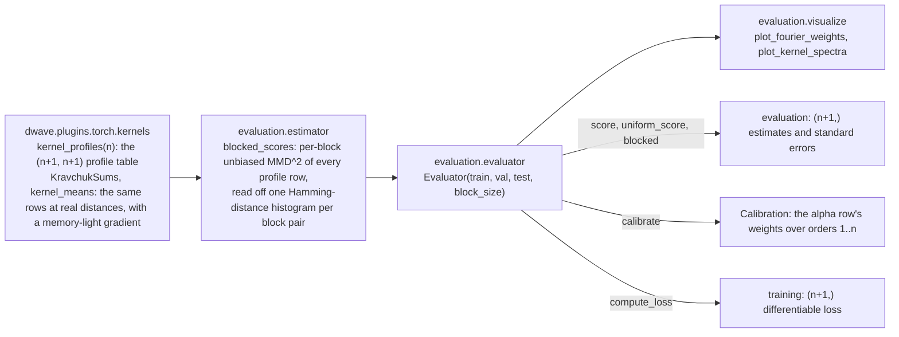
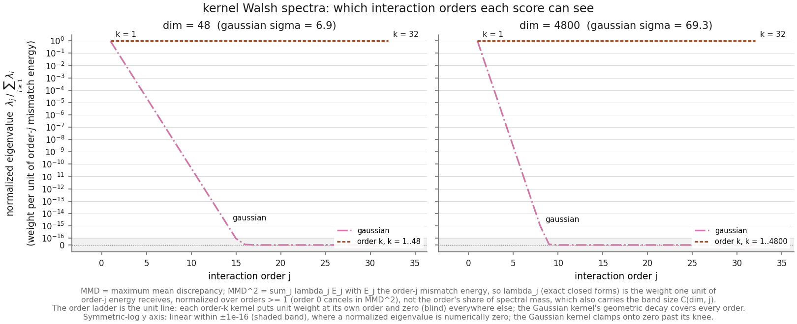

# Evaluation: kernel scores by interaction order

You have a generative model of $n$-bit binary data (a Boltzmann machine, a
quantum-processing-unit (QPU) sampler, any black box that emits rows of spins in
$\{-1,+1\}^n$) and only samples to judge it by: no likelihood. Ad-hoc statistics either miss
structure (matching the per-bit means says nothing about correlations) or lose sensitivity as
$n$ grows, and a plug-in discrepancy with unknown bias and no error bar cannot say whether a
small number means "close" or "unresolved". The subpackage `dwave.plugins.torch.evaluation`,
with the kernels of `dwave.plugins.torch.kernels`, measures the distance between a model's
samples and the data with **kernel scores**, proper scoring rules whose expected-score
divergence is half a squared maximum mean discrepancy (MMD); every number here is the full
$\mathrm{MMD}^2$, decomposed by **interaction order** (order 1 the per-bit means, order 2 the
pairwise correlations, order $k$ the $k$-way parities), each estimated without bias and with a
standard error, and read against the data's own distance from the uniform distribution. One
`Evaluator` serves three uses of the battery: an **evaluation score** for a full-size sample
against a held-out split, a **calibrated headline** whose per-order weights follow the structure
the data demonstrably carry, and a differentiable **training loss** for a batch of (possibly
soft) generated spins, the same loss that `dwave.plugins.torch.nn` provides as
`maximum_mean_discrepancy_loss`, `MaximumMeanDiscrepancyLoss` and the `SquaredMMD` statistic
of the `Ising` layer.

## Quickstart

```python
import torch
from dwave.plugins.torch.evaluation import Evaluator

# x_train, x_val, x_test: floating spin matrices in {-1, +1} of shape (rows, dim), one dim, one
# dtype, one device; the computation runs in them as given. Every split must be a whole number
# of at least eight blocks of `block_size` rows (the evaluator raises rather than trims).
evaluator = Evaluator(x_train, x_val, x_test, block_size=1024)

# Evaluation: exactly unbiased blocked MMD^2 estimates with standard errors, one entry per
# profile: [0] the headline kernel, [k] the order-k kernel for k = 1..dim
scores, se = evaluator.score(x_gen, "test")        # x_gen: the test split's shape, IID rows
data, data_se = evaluator.uniform_score("test")    # the data's own distance from uniform
captured = 1 - scores / data                        # per order: 1 = all of it, 0 = none of it
print(f"order 2: misfit {scores[2]:.3e} +- {se[2]:.1e} of the data's {data[2]:.3e}")

# Calibrated headline: two-level kernel weights fitted on the calibration splits (train + val),
# never on the rows being scored; profile 0 becomes the alpha row, and the record carries the
# weights, the measurable orders, and the per-order quantities that set them
calibration = evaluator.calibrate()                 # a Calibration; the weights are now held
scores, se = evaluator.score(x_gen, "test")
data, _ = evaluator.uniform_score("test")
print(f"normalized headline {scores[0] / data[0]:.3f}")   # 0 perfect, 1 captured nothing

# Training: a differentiable per-profile loss for a batch of hard or soft generated spins;
# x_batch is a generator's output carrying autograd history (or a leaf with requires_grad)
loss = evaluator.compute_loss(x_batch, block_size=128)   # against a random training batch
loss[0].backward()                                  # [0] the headline; loss[k] an order alone
```

`python examples/evaluation.py --outdir docs/media` renders the figures of this document from
samples of a Boltzmann machine, prints one calibration and one training-loss call, and
regenerates `docs/media/` in place. The machinery is four modules in one chain:



**Inputs.** `Evaluator(train, val, test, block_size=4096, alpha=None)`.

- `train`, `val`, `test`: floating-point spin matrices with every entry $-1$ or $+1$ (any other
  value, or an integer or boolean dtype, raises `ValueError`), shape $(\text{rows}, n)$ with one
  common $n$; row counts may differ. Models are fit on `train`, which is also the default
  reference of the training loss; `train` and `val` are the *calibration* splits, the only data
  `calibrate` reads; `test` is the default reference of the evaluation score, though any split
  can be scored against.
- Every split is cut once into blocks of `block_size` rows, consumed in storage order, and its
  row count must be a whole number of blocks giving at least eight of them (32,768 rows at the
  default; pass a smaller `block_size` for smaller splits).
- The rows of each split, and of every generated sample, must be independent and identically
  distributed (IID) draws, and the samples independent of each other. A sample whose *storage
  order* is structured (sorted by label, grouped by writer, the reads of one hardware
  submission) is permuted once by you, and that order kept: consumed as stored, its blocks are
  different generators and every score inflates ([The estimator](#the-estimator)).
- **Your dtype and device are the computation's.** Nothing is cast or moved: every Gram,
  histogram, score, and loss is computed in the splits' dtype on their device, the kernel table
  is allocated to match the training split, and a split, sample, batch, or `alpha` that differs
  fails inside torch with its usual error. Float64 reproduces each exact kernel profile to about
  $2 \times 10^{-14}$ per entry and counts pairs exactly at any block size; float32 to about
  $5 \times 10^{-7}$ up to $n = 200$ (about $2 \times 10^{-5}$ at $n = 4800$), with exact counts while `block_size` $\le 4096$ (the constructor raises
  above that, as does `blocked_scores` itself). Integer spins are refused rather than cast: an
  int8 Gram wraps silently on the
  CPU, and integer matmul is not implemented on CUDA. A split's reference half — its blocks'
  histograms and its distance from the uniform distribution — is computed on first use and
  cached.
- `alpha`: kernel weights over orders $1..n$ to hold from the start — a 1-D tensor of $n$
  finite, nonnegative entries with at least one positive, in the splits' dtype and device, held
  as a copy *as given* (nothing is normalized). `None`, the default, keeps the Gaussian
  headline; `calibrate` fits and assigns the weights later.

**Outputs.** Every result is indexed by *profile*, the same convention for a loss and a score:
`[0]` the **headline kernel** — the alpha row while kernel weights are held, else `gaussian` —
and `[k]` the order-$k$ kernel, $k = 1..n$. `evaluator.profiles` is the $(n+1) \times (n+1)$
table in force, in the splits' dtype (row $j$ the profile behind entry $j$,
[The kernel battery](#the-kernel-battery)), and `evaluator.profile_names` its row names
(`"alpha"` or `"gaussian"`, then `"order 1"`, `"order 2"`, …).

- `score(xquery, split)` → `(scores, se)`, tensors of $n + 1$ entries in the split's dtype on
  its device: the exactly unbiased estimate of $\mathrm{MMD}^2$ between the sample and the
  split under each kernel, and its standard error over the split's blocks — the standard
  deviation of the $B$ per-block estimates divided by $\sqrt{B}$. Smaller is better;
  the population value is zero exactly when the sample's law matches the data on every order
  the kernel sees. At entry $k$ the unit is the mean squared error per order-$k$ parity
  coefficient, bounded by $4$. Estimates are unbiased, hence sometimes negative; nothing is
  clipped.
- `uniform_score(split)` → the same pair for the split against the analytic uniform
  distribution: at entry $k$ the data's **Fourier weight** at order $k$, the most a model can
  miss there ([Reading a score](#reading-a-score)).
- `calibrate(ratio=10.0, eps=1e-3, test_blocks=None)` → a `Calibration` record, and the fitted
  weights are now held as `alpha`: `alpha` (the weights, summing to 1), `fourier_weight` and `se`
  (the calibration data's per-order Fourier weight and its standard error, pooled over the
  `train` and `val` blocks), `resolved` (the measurable orders, the gate that sets the weights),
  `noise` (the per-order floor), `ratio` and `test_blocks` as used, `floor`, `effective_floor`,
  and `shares` (each order's share of the headline's baseline), plus `num_blocks`
  ([The alpha row and its calibration](#the-alpha-row-and-its-calibration)). A bad dial — a
  non-positive or non-finite `ratio`, `eps` outside $(0, 1)$, `test_blocks` below 1 — raises
  `ValueError` and leaves the weights untouched, as does a `train` split shorter than `val`.
- `compute_loss(xquery, block_size=None, x=None, split="train")` → one tensor of $n + 1$ entries
  in the batch's dtype, each an unbiased estimate of the same $\mathrm{MMD}^2$ for the batch
  against a batch of the split, differentiable in `xquery`
  ([The training loss](#the-training-loss-and-the-kravchuksums-derivation)).
- `blocked(xqueries, split)` → a `BlockedScores` record for several models at once. `xqueries`
  is a mapping from a model name to a spin matrix of the split's shape; block $b$ of every query
  is its rows $[br, (b+1)r)$, scored against block $b$ of the split. The record holds `scores`
  of shape (profiles, models, blocks) — the raw per-block estimates, so any two models can be
  compared block by block — with `model_names` (in the mapping's order), `num_blocks`, and
  `block_size`. A query value may be the marker `UNIFORM` (from `dwave.plugins.torch.evaluation`)
  for the analytic uniform model.
- `alpha` is a read/write property: assign a weight vector to hold it (profile 0 becomes the
  alpha row and `profile_names[0]` reads `"alpha"`), assign `None` to return to the Gaussian
  headline; `calibrate` assigns it for you.

The evaluator reports estimates and uncertainties, never a verdict: read `scores / se` as a
signal-to-noise ratio and supply your own criterion.

## The kernel battery

Every score is $\mathrm{MMD}^2_\kappa(P, Q)$ for a **Hamming-isotropic** kernel
$\kappa(x, y) = f(d_H(x, y))$, a function of the Hamming distance $d_H$ alone — the number of
coordinates where two spin vectors differ. Such a kernel diagonalizes in the Walsh (parity)
basis with eigenvalues that depend only on interaction order, so each member's loss geometry is
known in closed form. The Walsh coefficient $W_P[S] = \mathbb{E}_P\,\chi_S(X)$ is the mean under
the data law $P$ of the parity $\chi_S(x) = \prod_{i \in S} x_i$ over a set $S$ of spins; $|S|$
is its *order*, and the $\binom{n}{k}$ parities of order $k$ form the order-$k$ *band*.

| profile | kernel | $f(d_H)$ | orders seen | propriety |
|---|---|---|---|---|
| `[0]`, no weights held | `gaussian` | $e^{-d_H/\sqrt{n}}$ | all, geometric decay | strictly proper — the validated workhorse |
| `[0]`, weights held | alpha row | $\sum_k \alpha_k K_k(d_H)/\binom{n}{k}$, $\alpha \ge 0$ | every order with $\alpha_k > 0$ | proper; strictly proper iff every $\alpha_k > 0$ |
| `[k]`, $k = 1..n$ | order $k$ | $K_k(d_H)/\binom{n}{k}$ | exactly $k$ | proper, blind off its band |

$K_k(d) = \sum_j (-1)^j \binom{d}{j} \binom{n-d}{k-j}$ is the degree-$k$ Kravchuk polynomial
(after Mykhailo Kravchuk; "Krawtchouk" in the older literature): the sum of the parity
agreements $\chi_S(x)\chi_S(y)$ over the order-$k$ band at distance $d$. The order-$k$ kernel is
therefore the *average* parity agreement over its band — unit diagonal, values in $[-1, 1]$ —
and its $\mathrm{MMD}^2$ is the mean squared error per order-$k$ Walsh coefficient: the order-$k$
**Fourier weight** of the mismatch. On spins $d_H = \lVert x - y \rVert_2^2 / 4$, so the
`gaussian` row is the Gaussian radial-basis-function kernel in Euclidean metric at bandwidth
$\sigma = \sqrt{n}$, hard-coded because the Hamming distance of independent coordinates
concentrates in an $O(\sqrt{n})$ band and a kernel that does not track that band degenerates as
$n$ grows ([Methods](#methods)). `kernel_profiles(n)` is the fixed table; an evaluator swaps its
alpha row in at row 0 while it holds weights.

**"Proper, not strict" is a feature.** An order-$k$ entry is a valid yardstick that is
deliberately blind off its band, so agreement at order 1 plus a large order-2 misfit localizes a
mismatch to pairwise structure. `gaussian` is strictly proper: its population score is zero only
at an exact match. The spectra make each fixed member's reach explicit:



*`plot_kernel_spectra`: each fixed member's Walsh eigenvalue at order $j$, normalized over
orders $\ge 1$: the weight one unit of order-$j$ mismatch energy $E_j = \sum_{|S|=j}(W_P[S] - W_Q[S])^2$
receives, since $\mathrm{MMD}^2 = \sum_j \lambda_j E_j$. The ladder is the unit line (each order
kernel is a single band); the Gaussian kernel decays geometrically with ratio $\tanh(1/(2\sqrt{n}))$,
faster at larger $n$, and clamps onto zero on the symmetric-log axis once its normalized
eigenvalue drops below $10^{-16}$: near order 14 at $n = 48$, near order 8 at $n = 4800$, the
working-graph scale of a QPU. The orders past the knee are the ones the Gaussian kernel cannot
see in practice.*

**The alpha row.** Kernel weights `alpha` — a vector over orders $1..n$ of finite nonnegative
values with a positive sum — turn profile 0 into the combination
$\kappa_\alpha = \sum_k \alpha_k K_k / \binom{n}{k}$, whose Walsh eigenvalue at order $k$ is
$\alpha_k / \binom{n}{k}$: proper for every admissible $\alpha$, strictly proper exactly when
every weight is positive, and a zero weight switches its order off. The weights are held as
given, so the row's value at distance 0 is $\sum_k \alpha_k$; only the weights `calibrate` fits
sum to 1, which gives the calibrated row the unit diagonal of every fixed kernel. By linearity
every alpha-row per-block score, and hence every loss, is the same combination of the order
rows' per-block values; the alpha row's standard error is the spread of those combined block
scores, not a combination of the order rows' standard errors.

## Reading a score

The uniform distribution $U$ on $\{-1,+1\}^n$ is the interaction-free reference: every Walsh
coefficient of order $\ge 1$ is zero. The data's distance from it, $\mathrm{MMD}^2_\kappa(P, U)$,
is therefore the structure the data carry on the orders the kernel sees — at entry $k$ exactly
the mean squared order-$k$ coefficient, the data's Fourier weight per coefficient. No sample of
$U$ is needed: for a Hamming-isotropic kernel the mean $\mathbb{E}_{Y \sim U}\,\kappa(x, Y)$ is
the same constant $\lambda_0$ for every $x$ (`uniform_kernel_mean`), so the estimate is the
within-block data U-statistic minus that constant, with no cross-term noise. A model whose score
at order $k$ equals the data's weight there has captured nothing at that order; one at noise
level has captured all of it this sample size resolves. Which orders that is, the report says
itself: an order where the data's own weight sits within a few standard errors of zero carries
no measurable structure at this sample size (the calibration's gate asks for three).

`plot_fourier_weights(evaluator, {"fit": evaluator.score(x_fit, split), ...}, split)` draws
the order-resolved view for up to four fits. The figures come from `examples/evaluation.py`:
the data are samples of a graph-restricted Boltzmann machine on a random 4-regular graph of 48
nodes with random biases (the *teacher*; linear biases of standard deviation 0.3, couplings of
standard deviation 1), drawn by a `BlockSampler` with one chain per row swept 1000 times from a
random state, and cut into splits of 16,384, 4,096 and 8,192 rows blocked at 512 rows (32, 8
and 16 blocks). Four candidates are scored against the test split: `IndependentBernoulli` and
`DichotomizedGaussian` of [`dwave.plugins.torch.models`](baselines.md), fit on the training
split and sampled once each; a *student*, a Boltzmann machine on the teacher's graph after 25
steps of persistent contrastive divergence on the training split (the training loop of
`examples/boltzmann_machine.py`); and a fresh, independent sample of the teacher itself. None
can replay rows of the data, so the novelty gate of [The estimator](#the-estimator) is not
needed here. The example is seeded, so a rerun reproduces the figures.

![Fourier weight by interaction order on samples of a Boltzmann machine on 48 nodes, all 48 orders: the data's weight (green) falls from about 0.1 at orders 1 and 2 over five decades to the noise level around order 24, where estimates scatter around zero and clamp onto the floor of the symmetric-log axis; from about order 36 the estimates and their error bars grow again toward order 48; the independent-Bernoulli fit coincides with the data's weight from order 2 on, the student's misfit runs a factor of a few below the data's weight, the dichotomized Gaussian's misfit runs two decades below it at the low orders and reaches the floor by order 16, and the teacher's misfit sits at the floor everywhere](media/fourier_weights.png)

*Every order. Green: the data against the analytic uniform distribution, its Fourier weight
per order, falling over some five decades from orders 1 and 2 to the noise level of this sample
size, which it clears by three standard errors at 22 of the 48 orders. Beyond, the estimates
scatter around zero (negative ones clamped onto the floor of the symmetric-log axis; the
footnote counts them), and toward order 48, where each band holds few coefficients, the
standard errors grow by decades and the drawn values grow with them: read that end against its
bars, not as spectroscopy. The fits' misfits coincide with the data's weight wherever a model
captures none of an order's structure: the independent-Bernoulli fit (orange) from order 2 on,
since it represents no interaction at all.*


*The first 12 orders. At order 1 every fit captures the means (the independent-Bernoulli fit
0.99 of the data's weight). From order 2 on they separate: the independent-Bernoulli fit
(orange) captures 0.17 of the data's order-2 weight and almost nothing at order 4 (what looks
like partial capture is the part of the higher-order weight the means alone imply); the student
(vermillion, dash-dot) captures 0.82 at order 2, 0.61 at order 4 and 0.44 at order 6, the low
orders first, as a Boltzmann machine learns them; the dichotomized Gaussian (blue, dashed),
matched to the means and pairwise tables, captures 0.997 at order 2 and 0.96 to 0.98 at orders
3 to 6: for this teacher, nearly all of the structure a sample of this size resolves is pairwise
or implied by the pairwise tables under the Gaussian family; and the teacher's own sample (pink,
dotted) reads at the floor at every order, the mark a perfect model leaves.*

## The alpha row and its calibration

The Gaussian headline weighs the orders by a fixed profile — as convex weights over the order
rows it is $\alpha_k \propto \binom{n}{k}\,\tanh(1/(2\sqrt{n}))^k$, a binomial bump near
$k \approx \sqrt{n}/2$ — whatever the data look like. `calibrate` replaces that profile with a
two-level one that follows what a sample of the test split's size can *measure*: the orders at
which a model that misses the data's structure can be told from one that reproduces it share
almost all of the weight equally, and every other order shares a small floor. The headline then
penalizes a model for missing structure the data demonstrably carry and forgives structure it
imposes where the data carry little. The rule, for orders $k = 1..n$:

$$
\alpha_k =
\begin{cases}
(1 - \varepsilon) / m & k \in M, \\
\varepsilon / (n - m) & k \notin M,
\end{cases}
\qquad
M = \big\{ k : \hat f_k - 3\,\widehat{\mathrm{se}}_k > 0 \ \text{ and }\ \hat f_k \ge \rho\,\hat\sigma_k > 0 \big\},
\qquad
m = |M|,
$$

where $\hat f_k$ and $\widehat{\mathrm{se}}_k$ are the per-order scores of `train` and `val`
against the analytic uniform distribution, pooled block by block (both splits share the block
size) — their mean and standard error over the pooled blocks; $\hat\sigma_k$ is the per-order
**floor**, the standard error over the test split's $B$ blocks of real data scored against real
data; $\rho$ is `ratio` (default 10) and $\varepsilon$ is `eps` (default $10^{-3}$). Three
ingredients:

1. **The data's weight, per coefficient.** $\hat f_k$ is `uniform_score` on the calibration
   data — bounded by 1, in the same units at every order, and free of the band size
   $\binom{n}{k}$, so it cannot pull the mass into the central orders the way a rule stated on
   the eigenvalues would. It is what a model that misses order $k$ entirely scores there.
2. **The floor.** The first `val`-sized rows of `train` are scored against the `val` blocks
   with `blocked`; each order's block standard deviation, divided by $\sqrt{B}$ for the $B$
   blocks of the split the weights will score against (`test_blocks`, by default the test
   split's count), is what a sample that *reproduces* the data's law scores at order $k$ — the
   spread of a degenerate U-statistic, far below the data's weight at the orders that carry
   structure and comparable to it at the orders that do not.
3. **The gate.** Order $k$ is **measurable** when it is *resolved* — $\hat f_k$ is a lower
   confidence bound above zero at three standard errors, so the structure is demonstrably
   there — and $\hat f_k \ge \rho\,\hat\sigma_k$, so a test-sized sample that misses it reads
   $\rho$ floors above one that reproduces it. Both conditions are needed. The floor is tiny at
   the middle orders, where the two-sample statistic is nearly degenerate, and an unresolved
   $\hat f_k$ there — estimation noise of the size of its own standard error — still exceeds
   $\rho$ floors by chance; without the resolution gate those orders would be weighted as if
   they carried structure. Conversely a resolved order whose weight is within a few floors of
   zero carries structure the test split cannot see.

The measurable orders share $1 - \varepsilon$ equally and every other order shares
$\varepsilon$, so every weight is strictly positive and the alpha row is characteristic. With no
measurable order the weights are flat and `calibrate` warns (`RuntimeWarning`) that the
calibration data carry no resolved structure a test-sized sample can see above its own floor:
flat by default, not by choice. With every order measurable the weights are flat as well, with
nothing left to floor. The record's `effective_floor` is the flat mass in force — $\varepsilon$,
or 1 and 0 in those two cases.

The weights depend on the calibration splits alone — never on the rows to be scored, never on a
candidate; the test split enters only through its block count — so every model then meets one
kernel on the same blocks. Choosing a battery from the scored rows biases paired comparisons by
more than half a standard error at eight blocks, an effect `TestBatteryIndependence` measures by
Monte Carlo, which is why the evaluator holds three splits and the calibration may read only
two. `calibrate` returns a `Calibration` — `alpha`, `fourier_weight`, `se`, `resolved` (the
measurable orders), `noise` (the floor), `ratio`, `test_blocks`, `floor` ($\varepsilon$),
`effective_floor`, `shares`, `num_blocks` — and holds the weights; every tensor is in the
splits' dtype on their device.

**What the headline says.** With the weights in force, `score(...)[0]` is
$\sum_k \alpha_k\, e_k$, the per-order mean squared errors $e_k$ averaged over the measurable
orders, up to the floor. Read it against `uniform_score(split)[0]`, the alpha row's baseline
$u_\alpha = \sum_k \alpha_k f_k$: a model that captures nothing reads $u_\alpha$, a perfect one
$0$, and their ratio is the **normalized headline** — a diagnostic to report *beside* the raw
score, never in its place, since it is a ratio of two estimates (not itself unbiased), exceeds 1
when a model adds structure the data lack, counts imposed coefficients and sign errors exactly
like omitted ones, and degenerates as the data approach uniform. `Calibration.shares`,
$s_k = \alpha_k \hat f_k / \sum_j \alpha_j \hat f_j$, says where that baseline lives order by
order — they are what the headline measures, so report them with the calibration.

**The forgiving bound.** At an unmeasurable order the data's own weight is at or near the
floor, so a per-order score there is at most about the structure the model imposes, itself at
most 1: the unmeasurable orders together cost any model at most about $\varepsilon$ in raw
headline units, and never more than $4\varepsilon$, since every per-order score lies in
$[-4, 4]$ block by block. Both bounds are raw; relative to the baseline they are
$\varepsilon / u_\alpha$ and grow without limit as the data approach uniform.

**What it costs, and the two dials.** The headline follows what the test split can measure, not
how much of the data's weight each order carries: on means-dominated data the low orders are
measurable and the high ones are not, and the measurable orders then count equally however
their weights differ, so a model's misfit at order 1 and at the last measurable order weigh the
same. On the samples of the Boltzmann machine of `examples/evaluation.py` (48 spins; a test split
of 16 blocks of 512 rows) the data's weight clears three standard errors at 22 orders and 16
of them are measurable, each carrying 6.2 % of the weight; the four candidates read normalized
headlines of 0.55 (independent Bernoulli), 0.18 (the student), 0.013 (the dichotomized
Gaussian) and 0.006 (the teacher), in the order the Gaussian kernel ranks them. The resolution *among good fits* lives where their
differences do, at the orders whose structure is a few per cent of order 1's, and the per-order
rows resolve it at once. `ratio` is
the first dial: how many floors above a perfect sample a model that misses an order must read
for the order to count — larger keeps fewer, more clearly measurable orders. `eps` is the
second: the share of the weight that ignores the data, hence how forgiving the row is at the
unmeasurable orders; `calibrate` refuses $\varepsilon = 0$, which would leave the row
non-characteristic. Neither is a tuning parameter to fit to the candidates.

## The estimator

`blocked_scores` splits the reference sample once into $B$ blocks of $r$ rows and scores every
model against the *same* blocks. Each block yields an exactly unbiased U-statistic estimate of
$\mathrm{MMD}^2$ — the within-sample terms over ordered off-diagonal pairs, the cross term over
all $r^2$ pairs — so the $B$ values carry finite-sample uncertainty, and sharing the blocks pairs
every comparison: in each per-block difference between two arms the within-reference term
cancels exactly and the reference-driven noise drops out, the classical common-random-numbers
variance reduction ([Methods](#methods)). Each block pair is reduced once to its
Hamming-distance histogram — the Gram of $\pm 1$ spins is an exact integer in the sample's own
floating dtype while $n$ fits its mantissa, and `torch.histc` counts the distances into unit bins
centered on the integers, exact while a block pair's $r^2$ pairs fit too ($2^{24}$ in float32, so
$r \le 4096$ there; $2^{53}$ in float64) — and every kernel's U-statistic is a dot product of its
profile row with those counts, so the complete battery costs one $(K, n+1)$ matrix-vector
product per block pair. Nothing is cast: the table is allocated in the sample's dtype
(`kernel_profiles(n, x.dtype, x.device)`), and the sample, the models, and the table must agree.
`Evaluator.blocked(xqueries, split)` is `blocked_scores` with the split as the reference, the
split's cached histograms, and the battery in force as the table; `score` and `uniform_score`
are its means and standard errors over blocks.

**Preconditions.** Unbiasedness and valid standard errors need IID rows within each sample and
independence between samples. Exchangeability alone does not suffice — a mixture of IID laws is
scored as the mixture of per-component discrepancies — and shuffling a *correlated* source
(consecutive Markov-chain states, the reads of one hardware submission) removes only the
*blocking* bias, the inflation that comes from blocks that are each a different generator, not
the dependence itself: a residual floor remains, measurable by scoring a held-out split of the
same source as a model. A merely structured storage order of independent rows (a file sorted by label, or
grouped by writer) is the benign case: one permutation restores everything.

**One knob.** `block_size` is $r$; $B = m/r$ must be at least 8 for every split so that each
block standard deviation rests on at least seven degrees of freedom. Work is $O(m r)$ per model,
shared by every kernel; near an exact match the smallest resolvable misfit scales like
$1/\sqrt{m r}$. The default 4096 is sized for large samples (a 60,000-row sample trimmed to
57,344 rows gives 14 blocks); the example's 8,192-row test split uses 512-row blocks for 16.

**Rules that keep scores comparable.** (1) Gate for novelty first: no two-sample score detects
memorization (a model that replays rows of the data's law scores at the data-versus-data
floor, as well as any model can), so check that a candidate that saw the data does not replay
it before its scores mean anything. (2) One evaluator and
one split per comparison — the same rows in the same order, identically shaped samples, one
block size and one set of kernel weights fixed before the scored rows are seen. (3) Sampler
settings that define the target distribution (a QPU's `auto_scale`, its annealing schedule) stay
fixed across candidates.

## The training loss and the `KravchukSums` derivation

`compute_loss(xquery, block_size=None, x=None, split="train")` is the battery as a loss, the
`maximum_mean_discrepancy_loss` of `dwave.plugins.torch.nn.functional` with the evaluator's
kernel weights and a reference batch of a split. `xquery` is a batch of $m$ generated rows
(hard spins, or *soft* spins with entries in $[-1, 1]$, a `tanh` output or the straight-through
spins of `gumbel_spins`) with or without autograd history. `x` is a reference batch of the same shape from
the data; by default a fresh random draw of $m$ distinct rows of the split (unseeded, like
everything in this repository; the batch may not exceed the split's rows), or pass the rows
your data loader produced. With `block_size=None` the whole batch is one block, the plain
U-statistic over all $m(m-1)$ within-sample pairs and $m^2$ cross pairs; a divisor
`block_size` $\ge 2$ of $m$ (anything else raises `ValueError`) cuts both batches into
$m/\texttt{block\_size}$ blocks, scored block against block and averaged (the paired
construction of `score`), with Gram work and memory falling from $O(m^2)$ to
$O(m \cdot \texttt{block\_size})$. The result
has $n + 1$ entries in the batch's dtype — which the reference batch must share; nothing is
cast — each back-propagating into `xquery`: `loss[profile].backward()`. With kernel weights held,
`loss[0]` is the alpha row, $\alpha$ applied to the order entries.

The rest of this section derives the one piece of the loss that is not plain autograd, the
`KravchukSums` function of `dwave.plugins.torch.kernels`, step by step.

### Motivation: autograd is correct here, and too hungry

The kernels are functions of a distance, and a distance is a function of an inner product, so
the whole loss is differentiable with ordinary torch operations — the Gaussian row is a single
`exp`, and the order rows come from a three-term recurrence that is nothing but multiplications
and additions. Written that way, autograd gives the right gradient. The cost is memory. To
differentiate a recurrence, autograd keeps every intermediate it will need in the backward pass:
one row $R_k$ per order, each a vector over all $E$ Gram entries, so the graph holds about
$(n + 1) \cdot E$ floats between forward and backward. A single-block loss on a 1024-row batch
has $E \approx 2m^2 \approx 2 \times 10^6$ entries across its two differentiable terms; at
$n = 279$ that is $280 \times 2 \times 10^6$ floats — about $4.7$ GB in float64 — for one loss
evaluation. Blocking helps only linearly: with $m/\texttt{block\_size}$ blocks the total is
$E \approx 2 m \cdot \texttt{block\_size}$, still multiplied by $n + 1$.

`KravchukSums` removes the factor $n + 1$. Its forward pass returns only the $n + 1$ sums the
loss needs, keeping nothing but the distances; its backward pass recomputes the rows in one more
sweep, carrying their derivatives alongside, and accumulates the gradient into a single vector
of length $E$. Memory is about a dozen length-$E$ vectors per call — the two differentiable
terms are separate calls of about $10^6$ entries each, so roughly $0.1$ GB in the example
above — and the sweep runs in the batch's dtype. The price is a hand-written backward, which is
why it is proved correct
([Step 6](#step-6--the-two-sweeps-assembled-and-the-proof-that-backward-is-the-gradient)) and
verified against finite differences ([Step 7](#step-7--what-the-tests-pin)).

### Step 1 — kernels as functions of the inner product

For spins $x, y \in \{-1,+1\}^n$ the Hamming distance is $d_H(x, y) = (n - \langle x, y \rangle)/2$,
so every profile $f(d_H)$ is a function of the Gram entry $\langle x, y \rangle$. The Gaussian row
is $f_0(d) = e^{-d/\sqrt{n}}$ and the order-$k$ row is

$$
R_k(d) = \frac{K_k(d)}{\binom{n}{k}}, \qquad K_k(d) = \sum_{j} (-1)^j \binom{d}{j} \binom{n-d}{k-j}.
$$

For a *soft* batch the Gram entry is real, and we define $d := (n - \langle x, y \rangle)/2 \in [0, n]$
and evaluate the same formulas. This is a modeling choice, not a theorem: at hard spins it is the
exact kernel, in between it is a smooth function of $x$ and $y$ through their inner product
alone, and the loss built from it is a smooth surrogate whose minimizers at the corners of the
cube are the hard-spin ones. The Gaussian row's extension $e^{-(n - \langle x, y \rangle) / (2 \sqrt n)}$
is a positive-definite kernel on soft points as well (the exponential of an inner product), so
the headline stays a squared MMD between the corners; the order rows' extensions, polynomials in
the inner product, are not positive definite off the corners (a Gram of the order-2 extension on
random `tanh` points has negative eigenvalues), so the order entries of a soft-spin loss are
smooth extensions of the hard-spin estimates, not squared MMDs of the soft points. What the
module owes the caller is exactness at hard spins and smoothness in between; Steps 2 and 5
deliver both.

### Step 2 — the recurrence, and why it holds at real distances

Kravchuk polynomials satisfy the three-term recurrence in the degree,

$$
(k+1)\, K_{k+1}(d) = (n - 2d)\, K_k(d) - (n - k + 1)\, K_{k-1}(d), \qquad K_0 = 1,\ K_1(d) = n - 2d.
$$

Both sides are polynomials in $d$ (a generalized binomial $\binom{d}{j}$ is a polynomial of
degree $j$), and two polynomials that agree at the $n + 1$ integers $d = 0..n$ — more points than
their degree — are identical, so the identity holds at every real $d$. Dividing by
$\binom{n}{k+1} = \binom{n}{k}\,\frac{n-k}{k+1}$ and using $\binom{n}{k-1} = \binom{n}{k}\,\frac{k}{n-k+1}$
turns it into the normalized recurrence the code runs:

$$
R_{k+1}(d) = \frac{(n - 2d)\, R_k(d) - k\, R_{k-1}(d)}{n - k}, \qquad R_0 = 1,\ R_1(d) = \frac{n - 2d}{n}.
$$

At integer $d$ every $R_k$ is an average of $\pm 1$ parity agreements, so it lies in $[-1, 1]$ and
nothing overflows, unlike the raw $K_k$, which exceeds the float range past
$\binom{n}{k} \sim 10^{308}$. The sweep is numerically stable while $k \le \lfloor n/2 \rfloor$,
where $\binom{n}{k}$ still grows; past the middle it divides rounding noise by a vanishing band
size and diverges (run past the middle at $n = 100$, it once returned $7 \times 10^{10}$ for
$R_{100}(1)$ instead of $-1$). Step 5 handles those rows; `TestProfiles` pins every row of the
shipped tables against exact big-integer arithmetic up to $n = 200$, with spot checks at
$n = 4800$.

### Step 3 — the sums, and the forward sweep

A loss term is a *mean* kernel value over pairs: over the $r(r-1)$ ordered off-diagonal pairs
within a block for the within-sample terms, over the $r^2$ pairs of two blocks for the cross
term. Collect the $E$ distances of one such set into a vector $d_1, \dots, d_E$ and define

$$
S_k = \sum_{e=1}^{E} R_k(d_e), \qquad k = 0, \dots, n,
$$

so the mean under profile $k$ is $S_k / E$ and the Gaussian mean is $\sum_e e^{-d_e/\sqrt{n}} / E$.
The forward pass sweeps $k$ upward with two live vectors, $R_{k-1}$ and $R_k$, writes $S_k$ as
each row is produced, and discards the row. Time $O(E n)$, memory $O(E)$. The block's
$\mathrm{MMD}^2$ under profile $k$ is then the familiar
$\text{within}_x + \text{within}_y - 2\,\text{cross}$ of these means, and the loss averages the
blocks. The within-reference term is a constant of the draw (`torch.no_grad`); the gradient comes
from the within-batch and cross terms.

### Step 4 — the gradient by the derivative recurrence

**What a backward pass owes.** `KravchukSums` is a `torch.autograd.Function`: its forward maps
the distance vector $d = (d_1, \dots, d_E)$ to the sums $S = (S_0, \dots, S_n)$, and its backward
receives the *upstream gradient* $g_k = \partial L / \partial S_k$ of whatever scalar loss $L$ is
later built from $S$ and must return the **vector-Jacobian product (VJP)**
$\partial L / \partial d_e = \sum_k g_k\, \partial S_k / \partial d_e$ — the chain rule through the
function, which autograd then continues through the Gram into the batch. Write $F_k$ for the
function of one distance that the forward evaluates in row $k$, so that $S_k = \sum_e F_k(d_e)$:
$F_k = R_k$ for the swept rows $k \le \lfloor n/2 \rfloor$, and the smooth reflection of Step 5
for the rows above them. Every $F_k$ equals $R_k$ at integer distances, so Step 3 is unchanged
at hard spins. Because $S_k$ depends on $d_e$ only through its $e$-th summand,

$$
\frac{\partial S_k}{\partial d_e} = F_k'(d_e),
$$

so the Jacobian of $S$ with respect to $d$ is the $(n + 1) \times E$ matrix with entries
$F_k'(d_e)$, and the VJP is, entry by entry,

$$
\frac{\partial L}{\partial d_e} = \sum_{k=0}^{n} g_k\, F_k'(d_e). \qquad (\star)
$$

Backward must produce $(\star)$ for every $e$ without holding the $n + 1$ rows. The lemma below
and Lemma 2 of Step 5 supply the derivatives $F_k'$; Step 6 proves that the sweep assembles
$(\star)$ exactly.

**Lemma 1 (the derivative recurrence).** For the swept rows,

$$
R'_{k+1}(d) = \frac{(n - 2d)\, R'_k(d) - 2\, R_k(d) - k\, R'_{k-1}(d)}{n - k}, \qquad R'_0 = 0,\ R'_1 = -\frac{2}{n}.
$$

*Proof.* $R_0 = 1$ and $R_1(d) = (n - 2d)/n$ give the two starting derivatives directly. Fix
$k \ge 1$ and differentiate the normalized recurrence of Step 2, in the form
$(n - k)\, R_{k+1}(d) = (n - 2d)\, R_k(d) - k\, R_{k-1}(d)$, with respect to $d$: the factors
$n - k$ and $k$ are constants, and the product rule on $(n - 2d)\, R_k(d)$ gives
$-2\, R_k(d) + (n - 2d)\, R_k'(d)$, so
$(n - k)\, R_{k+1}'(d) = (n - 2d)\, R_k'(d) - 2\, R_k(d) - k\, R_{k-1}'(d)$; divide by $n - k > 0$.
The forward *defines* its swept rows by the recurrence of Step 2, so by induction on $k$ each is
a polynomial in $d$ — a finite composition of sums and products of polynomials — and the
differentiated recurrence is the derivative of exactly the function the forward computes; that
this function is also the Kravchuk polynomial is Step 2, not an assumption here. $\blacksquare$

The backward pass therefore runs the sweep of Step 3 once more, carrying the four vectors
$(R_{k-1}, R_k, R'_{k-1}, R'_k)$, and adds $g_k\, R'_k$ into a running vector as each derivative
is produced. Nothing is saved between forward and backward except $d$ itself
(`save_for_backward`), so the backward's memory is again a handful of length-$E$ vectors.

### Step 5 — the rows past $n/2$: the reflection and its derivative

At integer distances the upper half of the ladder is the lower half in disguise:

$$
R_{n-k}(d) = (-1)^d\, R_k(d), \qquad d \in \{0, \dots, n\}.
$$

**Proof.** Fix two spin vectors $x, y \in \{-1,+1\}^n$ and let $D = \{i : x_i \ne y_i\}$ be the
set of coordinates where they disagree, so $|D| = d_H(x, y) = d$. For any index set $S$ the
product of the two parities is $\chi_S(x)\,\chi_S(y) = \prod_{i \in S} x_i y_i$, and the factor
$x_i y_i$ is $-1$ exactly when $i \in D$, so

$$
\chi_S(x)\,\chi_S(y) = (-1)^{|S \cap D|}.
$$

Summing over the $\binom{n}{k}$ sets of size $k$ and grouping them by $j = |S \cap D|$ — $j$
elements chosen inside $D$, $k - j$ outside — gives
$K_k(d) = \sum_{|S| = k} (-1)^{|S \cap D|} = \sum_j (-1)^j \binom{d}{j} \binom{n - d}{k - j}$: the
closed form of Step 1, and the reason the kernel depends on $x, y$ only through $d$. Now
complement. The map $S \mapsto S^c = [n] \setminus S$ is a bijection from the $k$-subsets of
$[n]$ onto the $(n-k)$-subsets, and a complement meets $D$ in the elements $S$ misses, so
$|S^c \cap D| = d - |S \cap D|$. Hence

$$
K_{n-k}(d) = \sum_{|T| = n-k} (-1)^{|T \cap D|} = \sum_{|S| = k} (-1)^{\,d - |S \cap D|} = (-1)^d \sum_{|S| = k} (-1)^{|S \cap D|} = (-1)^d\, K_k(d),
$$

and dividing by $\binom{n}{n-k} = \binom{n}{k}$ gives $R_{n-k}(d) = (-1)^d\, R_k(d)$. The
identity is pointwise — a count of signs over index sets, with no distribution involved — so it
holds at every integer distance $d = 0, \dots, n$, that is, for every pair of hard spins.
$\blacksquare$

The second equality is the character identity behind the sketch one usually sees: since
$\chi_{S^c} = \chi_{[n]}\,\chi_S$ for the global parity $\chi_{[n]}(x) = \prod_i x_i$, each
complement's agreement is the original's times $\chi_{[n]}(x)\,\chi_{[n]}(y) = (-1)^{d}$. A second
route confirms it algebraically: $K_k(d)$ is the coefficient of $z^k$ in
$(1 - z)^d (1 + z)^{n-d}$ (expand both factors and match the closed form), the coefficient of
$z^{n-k}$ in a degree-$n$ polynomial $P$ is the coefficient of $z^k$ in $z^n P(1/z)$, and
$z^n (1 - 1/z)^d (1 + 1/z)^{n-d} = (z - 1)^d (z + 1)^{n-d} = (-1)^d (1 - z)^d (1 + z)^{n-d}$.
Two rows come out in closed form as a check: $R_n(d) = (-1)^d$ from $R_0 = 1$, and
$R_{n-1}(d) = (-1)^d (n - 2d)/n$ from $R_1$; the tests pin both against the table. The
first-principles note states the same result as its Proposition 6.4 and walks through it on a
small example.

The table in `kernel_profiles` uses the identity as is, filling the rows above $n/2$ from the
stable half of the sweep. For real $d$ the factor $(-1)^d$ has no meaning, so we choose its
smooth extension $\cos(\pi d)$, which equals $(-1)^d$ at every integer, and *define* the
reflected rows by

$$
F_{n-k}(d) := \cos(\pi d)\, R_k(d), \qquad k \le \lfloor n/2 \rfloor,
$$

computed from the stable half of the sweep — written $F$, in the notation of Step 4, because it
is the function the forward evaluates in row $n - k$: equal to the polynomial $R_{n-k}$ at every
integer, different from it elsewhere.

**Lemma 2 (the reflected derivative).**

$$
F_{n-k}'(d) = \cos(\pi d)\, R_k'(d) - \pi \sin(\pi d)\, R_k(d).
$$

*Proof.* The product rule, with $\frac{\mathrm{d}}{\mathrm{d}d} \cos(\pi d) = -\pi \sin(\pi d)$
and $R_k'$ from Lemma 1. $\blacksquare$

At integer $d$ the sine vanishes and the reflected derivative is $(-1)^d R_k'(d)$ — the
derivative of the extension, not of the degree-$(n-k)$ polynomial the unstable sweep would aim
at. The extension is a different smooth function that agrees with the exact kernel at every hard
spin — which is all the loss owes (Step 1) — and it costs nothing. Coverage is complete for both
parities of $n$ (Lemma 3 of Step 6 makes it precise): the sweep produces
$j = 0..\lfloor n/2 \rfloor$, and the reflections fill $k = n - j$ for every $j$ with
$n - j > \lfloor n/2 \rfloor$, that is $k = \lfloor n/2 \rfloor + 1, \dots, n$.

### Step 6 — the two sweeps, assembled, and the proof that `backward` is the gradient

Forward, for a distance vector $d$ of length $E$: start $R_0 = 1$, $S_0 = E$; if $n > \lfloor n/2 \rfloor$
also $S_n = \sum_e \cos(\pi d_e)$; then $R_1$, $S_1$, and its reflection $S_{n-1}$; then for
$k = 1, \dots, \lfloor n/2 \rfloor - 1$ produce $R_{k+1}$ from $(R_k, R_{k-1})$, write $S_{k+1}$
and, when $n - k - 1 > \lfloor n/2 \rfloor$, $S_{n-k-1} = \sum_e \cos(\pi d_e)\, R_{k+1}(d_e)$.
Backward, given $g_0, \dots, g_n$: run the same sweep carrying derivatives, and for each swept
row $j$ add $g_j\, R'_j$ and, when its reflection $n - j$ exists,
$g_{n-j}\,\big(\cos(\pi d)\, R'_j - \pi \sin(\pi d)\, R_j\big)$ into the gradient. Both passes cost
$O(E n)$ flops with $O(E)$ memory. The Gaussian row and the reduction from the Gram to $d$ stay
in plain autograd, and the alpha row of a calibrated evaluator is the weighted sum of the order
means, formed after the sums.

**Lemma 3 (every row exactly once).** Let $h = \lfloor n/2 \rfloor$. The sweep visits
$j = 0, 1, \dots, h$; it writes row $j$ directly and row $n - j$ as its reflection exactly when
$n - j > h$. Every index $k \in \{0, \dots, n\}$ is written exactly once.

*Proof.* The direct writes are $\{0, \dots, h\}$. The map $j \mapsto n - j$ is a bijection from
$\{0, \dots, h\}$ onto $\{n - h, \dots, n\}$, and the condition $n - j > h$ keeps exactly the
part of its image inside $\{h + 1, \dots, n\}$. For even $n = 2h$ the image is
$\{h, \dots, 2h\}$ and the condition drops the single point $j = h$, whose reflection is itself,
leaving $\{h + 1, \dots, 2h\}$; for odd $n = 2h + 1$ the image is $\{h + 1, \dots, 2h + 1\}$
and the condition drops nothing. In both cases the direct and the reflected writes partition
$\{0, \dots, n\}$. $\blacksquare$

The forward and the backward test the same condition on the swept index (`dim - k > half` in
`kernels.py`), so they agree row by row on which function $F_k$ each output is. The sums run
over the last axis of `d`, so one sweep also serves the row sums of the `SquaredMMD` statistic.

**Theorem (the backward pass returns the gradient).** For any upstream gradient $g$, the vector
`backward` returns has $e$-th entry $\sum_{k=0}^{n} g_k\, F_k'(d_e)$ — the VJP $(\star)$ of
Step 4, the exact derivative of the loss with respect to the distance $d_e$ for the functions
$F_k$ the forward computes.

*Proof.* Fix $e$. Every operation of the backward sweep is elementwise in $e$ — products with the
scalars $g_k$, sums of vectors, and the recurrences — so it suffices to follow the $e$-th entry
of the running vector, which starts at zero. In exact arithmetic the pair the sweep carries at
index $j$ is $(R_j(d_e), R_j'(d_e))$: true at $j = 0$ and $j = 1$ by the initial values, and
propagated by the recurrence of Step 2 and Lemma 1. At index $j$ the sweep adds
$g_j\, R_j'(d_e) = g_j\, F_j'(d_e)$, since $F_j = R_j$ for $j \le h$; if $n - j > h$ it also adds
$g_{n-j} \big( \cos(\pi d_e)\, R_j'(d_e) - \pi \sin(\pi d_e)\, R_j(d_e) \big) = g_{n-j}\, F_{n-j}'(d_e)$
by Lemma 2, since $F_{n-j}(d) = \cos(\pi d)\, R_j(d)$ is what the forward wrote into $S_{n-j}$.
By Lemma 3 every $k \in \{0, \dots, n\}$ receives exactly one such term, so after the sweep the
entry is $\sum_{k=0}^{n} g_k\, F_k'(d_e)$, which is $(\star)$. The second return value is
`None`: `dim` is an integer, not a tensor that carries a gradient. $\blacksquare$

Three remarks. First, the theorem is about the *surrogate*: `backward` differentiates exactly
the functions the forward evaluates, which is the contract a `torch.autograd.Function` owes and
what `gradcheck` tests; at hard spins the reflected rows' derivative is that of the smooth
extension, $(-1)^d R_j'(d)$, and the loss is a smooth surrogate there, as Step 1 says. Second,
the memory claim of the Motivation is read off the proof: at any moment the sweep holds the two
carried rows and their derivatives, the pair being formed, $\cos(\pi d)$, $\sin(\pi d)$,
$n - 2d$, and the running gradient — about a dozen vectors of length $E$, whatever $n$ is. Third,
the VJP form is why the alpha row costs nothing extra: `loss[k].backward()` for one order sends
a $g$ with a single nonzero entry, while the alpha row sends $g_j \propto \alpha_j$ for every
$j \ge 1$, and one sweep serves both at the same $O(E n)$ cost, since every term of $(\star)$ is
formed anyway.

### Step 7 — what the tests pin

`tests/test_kernels.py` and `tests/test_evaluation.py` hold the derivation to account. At integer distances the sums
reproduce every row of `kernel_profiles(n)` exactly, reflected rows included (in float64,
$\cos(\pi d)$ is exactly $\pm 1$ at integers). `torch.autograd.gradcheck` compares the
hand-written backward — the VJP $(\star)$ of Step 4, proved exact in Step 6 — with finite
differences at random real distances for even and odd $n$, so both cases of Lemma 3 are
exercised; more sharply, for an arbitrary upstream gradient the backward agrees to $10^{-13}$
with autograd run through the same rows written out in plain tensor operations — the Theorem
checked directly. On hard spins, `compute_loss` equals the histogram estimator of
`blocked_scores` to $10^{-8}$, profile by profile, single-block and blocked, with and without
kernel weights. A soft float64 batch passes an end-to-end `gradcheck` of the whole loss through
the Grams, the sweep, and the Gaussian row.

## Methods

**Propriety.** A scoring rule is *proper* when the truth minimizes its expected loss and
*strictly proper* when it is the unique minimizer (Gneiting & Raftery, 2007). For the kernel
score the induced divergence is $\tfrac12\,\mathrm{MMD}^2_\kappa(P, Q)$ (Gretton et al., 2012);
strict propriety holds exactly when the kernel is *characteristic* (Sriperumbudur et al., 2010),
which on $\{-1,+1\}^n$ is the spectral test "every Walsh eigenvalue of order $\ge 1$ is
positive"; plain propriety is "every such eigenvalue is nonnegative". `gaussian` passes the
strict test (and is universal, with a positive order-0 eigenvalue that $\mathrm{MMD}^2$ cancels
anyway); each order kernel is a single positive band; an alpha row has eigenvalue
$\alpha_k/\binom{n}{k}$ on band $k$ and no order-0 component, so a calibrated row — every weight
positive by the floor — is characteristic. The spectral facts rest on Walsh–Fourier analysis on
the hypercube (O'Donnell, 2014), with the Kravchuk polynomials as the eigenfunctions of the
Hamming association scheme (Delsarte, 1973; MacWilliams & Sloane, 1977).
The tests pin every eigenvalue by direct enumeration at $n = 8$ (`TestSpectra`).

**The Gaussian bandwidth.** $e^{-d_H/\sigma}$ is the hypercube heat kernel of Kondor & Lafferty
(2002), with Walsh weight decaying geometrically at ratio $\tanh(1/(2\sigma))$. For independent
coordinates the Hamming distance concentrates in an $O(\sqrt{n})$ band (Hoeffding, 1963), and a
kernel whose scale does not track it degenerates toward a means-only comparison (Ramdas et al.,
2015); $\sigma = \sqrt{n}$ keeps it non-degenerate at every $n$. For correlated data the choice
was *measured* rather than argued: in the experiments this design was validated on, model
ladders of known order and a held-out pseudolikelihood oracle were ranked with this kernel up to
$n = 4800$, and the blocked estimate's deviations from exact population scores were
standard-normal with its two-standard-error intervals covering at the nominal rate.

**The estimator.** Each block is the unbiased U-statistic estimator of $\mathrm{MMD}^2$ of
Gretton et al. (2012), with the machinery of Hoeffding (1948); scoring independent blocks and
reading their spread is the B-test construction of Zaremba et al. (2013), whose standard errors
here are plain sample statistics over independent blocks, valid at any $B \ge 8$. Sharing the
reference blocks is the paired-comparison identity
$\mathrm{Var}(A - B) = \mathrm{Var}\,A + \mathrm{Var}\,B - 2\,\mathrm{Cov}(A, B)$ with the
covariance engineered by common random numbers, the same device behind the relative-MMD test of
Bounliphone et al. (2016). For the uniform distribution the conditional mean embedding is the
constant $\lambda_0 = \sum_d \binom{n}{d} 2^{-n} f(d)$ — zero for every order kernel,
$((1 + e^{-1/\sqrt{n}})/2)^n$ for `gaussian` — so
$\mathrm{MMD}^2_\kappa(P, U) = \mathbb{E}_P\,\kappa(X, X') - \lambda_0$, which in the Walsh basis
is $\sum_{S \ne \emptyset} \lambda_{|S|} W_P[S]^2$: at entry $k$ the mean squared order-$k$
coefficient (the expectation is under $P$, the data law; the coefficients are bookkeeping in the
orthonormal Walsh basis). Near an exact match the per-block estimates are degenerate
U-statistics with a weighted-$\chi^2$ limit, so `scores / se` is a descriptive ratio, not an
exact test statistic. Under uniform data the per-block variance has a closed form
($4/(r(r-1)) + 4/r^2$ in units of $1/\binom{n}{k}$ for a sampled model, $2/(r(r-1))$ for the
analytic uniform arm), pinned by Monte Carlo in the tests; so is the selection bias of choosing
the battery from the scored rows (`TestBatteryIndependence`).

**The calibration.** Conditional on the calibration data, the weights are a fixed vector, so
every headline is the exactly unbiased blocked estimate of $\mathrm{MMD}^2_\alpha$ and every
comparison between candidates is paired on the same blocks. The gate is a pointwise
three-standard-error lower confidence bound per order *and* a margin of `ratio` floors over the
spread of a sample that reproduces the law: over many orders the first alone passes an
occasional false survivor, and the second alone admits the middle orders, where the floor is
nearly degenerate and an unresolved estimate exceeds it by chance — together they pass neither.
The rule carries no band-size factor and divides by no standard error, the two mechanisms that
collapse a data-driven weighting onto the central orders. `TestCalibrate` recomputes the gate and
the two weight levels by hand from the returned record, checks the measurable set of a
two-cluster mixture with an exact even-order spectrum, both forgiving bounds block by block, the
invariance to the test split, the two dials and the floor's scaling with the block count, and the
flat fallback with its warning.

**Numerics of the table.** Each order row of the float64 table is the exact profile to about
$2 \times 10^{-14}$ per entry (a float32 table to about $5 \times 10^{-7}$ up to $n = 200$ and
about $2 \times 10^{-5}$ at $n = 4800$), which certifies a
single band only while $\binom{n}{k}$ stays below about $5 \times 10^{13}$; past that, at central
orders once $n$ reaches the low hundreds, a reading is exact in absolute terms but no longer
attributable to order $k$ alone — those orders sit far below any practical noise floor anyway.
The float64 `gaussian` row is exactly positive semi-definite for $n \le 16$; at larger $n$ its
rounding errors leak into eigenvalues of either sign at the deep orders (from order 16 at
$n = 24$, order 11 at $n = 200$), an effect of order $10^{-16}$ that moves no score beyond
$4 \times 10^{-16}$. `TestExactTables` pins these bounds in rational arithmetic.

## Limitations

- **IID rows and independent samples are preconditions.** Dependent rows invalidate the standard
  errors; shuffling removes the blocking bias, not the dependence. A structured storage order of
  independent rows is cured by one permutation kept for every call.
- **No two-sample score detects memorization.** Gate for novelty first.
- **A split's shape, whole blocks.** Every scored sample must have its split's shape, and every
  split's row count must be a multiple of the block size giving at least eight blocks.
- **The calibrated headline counts only what the test split can measure, equally**, so on
  means-dominated data it is carried by the few low orders and resolves less among good fits
  than the Gaussian kernel or flat weights; the per-order rows keep that resolution. The
  normalized headline is a ratio of two estimates: not
  unbiased, above 1 for added structure, and meaningless as the data approach uniform.
  Forgiveness is per order, never within an order — a coefficient the model omitted and one it
  introduced, of equal size, cost the same — and an isotropic kernel dilutes a few large
  coefficients over their whole band, so sparse structure at a high order is invisible whatever
  the weights.
- **The loss's memory grows with the block.** `compute_loss` holds $O(m \cdot \texttt{block\_size})$ Gram
  entries (all $\approx 2m^2$ for a single block) in the batch's dtype; a batch of a few thousand
  rows wants a block of a few hundred. At soft spins the loss is a smooth surrogate; the
  estimator's guarantees are statements about hard spins.
- **Estimates are unbiased, hence sometimes negative.** Nothing is clipped; read a negative
  estimate with its standard error.
- **Deep central orders at large $n$ are noise, and past a crossover not attributable.** Mind the
  $(n + 1)^2$-float table at large $n$.
- **Nothing is cast or moved.** Every tensor you pass must share the splits' dtype and device;
  a mismatch is a torch error, never a silent conversion. A float32 evaluator carries about
  $10^{-6}$ of absolute rounding per score — use float64 for evaluation-grade numbers.
- **Exactness is bounded by your dtype's mantissa.** Grams and histogram counts are exact
  integers only while $n$ and `block_size`$^2$ stay below $2^{24}$ in float32 (the estimator
  raises past it) or $2^{53}$ in float64, which never binds. On CUDA, float32 matmul with
  TensorFloat-32 enabled (`torch.backends.cuda.matmul.allow_tf32`, off by default) rounds the
  Gram's $\pm 1$ sums past $n \approx 2000$; keep it off, or use float64.

## References

- Bounliphone, W., Belilovsky, E., Blaschko, M. B., Antonoglou, I. & Gretton, A. (2016). A test
  of relative similarity for model selection in generative models. *ICLR*.
  <https://arxiv.org/abs/1511.04581> — paired comparison of two models against one reference.
- Delsarte, P. (1973). An algebraic approach to the association schemes of coding theory.
  *Philips Research Reports Supplements* 10 — Kravchuk polynomials as the eigenfunctions of the
  Hamming scheme.
- Gneiting, T. & Raftery, A. E. (2007). Strictly proper scoring rules, prediction, and
  estimation. *JASA* 102, 359–378. <https://doi.org/10.1198/016214506000001437> — proper and
  strictly proper scores.
- Gretton, A., Borgwardt, K. M., Rasch, M. J., Schölkopf, B. & Smola, A. (2012). A kernel
  two-sample test. *JMLR* 13, 723–773. <https://jmlr.org/papers/v13/gretton12a.html> — the MMD
  and its unbiased estimator.
- Hoeffding, W. (1948). A class of statistics with asymptotically normal distribution. *Annals
  of Mathematical Statistics* 19, 293–325. <https://doi.org/10.1214/aoms/1177730196> —
  U-statistics.
- Hoeffding, W. (1963). Probability inequalities for sums of bounded random variables. *JASA*
  58, 13–30. <https://doi.org/10.1080/01621459.1963.10500830> — concentration of the Hamming
  distance.
- Kondor, R. I. & Lafferty, J. (2002). Diffusion kernels on graphs and other discrete input
  spaces. *ICML*. <https://dl.acm.org/doi/10.5555/645531.655996> — the hypercube heat kernel
  and its Walsh spectrum.
- MacWilliams, F. J. & Sloane, N. J. A. (1977). *The Theory of Error-Correcting Codes*.
  North-Holland — Kravchuk polynomials and the Hamming scheme.
- O'Donnell, R. (2014). *Analysis of Boolean Functions*. Cambridge University Press.
  <https://arxiv.org/abs/2105.10386> — Walsh–Fourier analysis on the hypercube; Fourier weight
  at a degree.
- Ramdas, A., Reddi, S. J., Póczos, B., Singh, A. & Wasserman, L. (2015). On the decreasing
  power of kernel and distance based nonparametric hypothesis tests in high dimensions. *AAAI*.
  <https://arxiv.org/abs/1406.2083> — bandwidth must track the dimension.
- Sriperumbudur, B. K., Gretton, A., Fukumizu, K., Schölkopf, B. & Lanckriet, G. R. G. (2010).
  Hilbert space embeddings and metrics on probability measures. *JMLR* 11, 1517–1561.
  <https://jmlr.org/papers/v11/sriperumbudur10a.html> — characteristic kernels.
- Zaremba, W., Gretton, A. & Blaschko, M. (2013). B-test: a non-parametric, low variance kernel
  two-sample test. *NeurIPS*. <https://arxiv.org/abs/1307.1954> — blocked MMD estimates and
  their spread.

## Files

- `dwave/plugins/torch/kernels.py`: `kernel_profiles(n)`, `uniform_kernel_mean`, the binomial
  and Kravchuk helpers, `KravchukSums`, the autograd function derived above, and
  `kernel_means`, the per-profile means at real distances behind every loss.
- `dwave/plugins/torch/evaluation/estimator.py`: `validate_spin_matrix`, `UNIFORM`, the block
  histograms, `BlockedScores`, and `blocked_scores`.
- `dwave/plugins/torch/evaluation/evaluator.py`: `Evaluator`: the three splits as passed,
  `compute_loss`, `score`, `uniform_score`, `blocked`, `alpha`, and `calibrate`, with its
  `Calibration` record.
- `dwave/plugins/torch/evaluation/visualize.py`: `plot_fourier_weights(evaluator, results,
  split)` and `plot_kernel_spectra`; Okabe-Ito colors doubled by line style, symmetric-log axes,
  headless-safe object-interface matplotlib (an optional dependency).
- `dwave/plugins/torch/nn/functional.py` and `dwave/plugins/torch/nn/modules/`: the same loss as
  `maximum_mean_discrepancy_loss` and `MaximumMeanDiscrepancyLoss`, and as the `SquaredMMD`
  statistic of the `Ising` layer, whose leave-one-out values the score-function gradient
  estimator of `expectation` uses.
- `examples/evaluation.py`: renders the three figures of this document into `docs/media/` from
  samples of a Boltzmann machine and four candidates, and prints one calibration and one
  `compute_loss` call.
- `tests/test_kernels.py`: the ladder's exact identities in rational arithmetic
  (`TestProfiles`, `TestExactTables`), the spectra against exact enumeration (`TestSpectra`),
  and the differentiable sums against the tables, finite differences and autograd through the
  unrolled recurrence (`TestKravchukSums`). `tests/test_evaluation.py`: the uniform arm and the
  alpha row against exact enumeration (`TestUniformArm`), the histogram estimator against its
  per-entry reference and the closed-form block variances (`TestEstimator`), the evaluator
  against `blocked_scores` (`TestEvaluator`), the calibration rule (`TestCalibrate`), the loss
  against the estimator and its gradients (`TestLoss`), the selection-bias measurement
  (`TestBatteryIndependence`), the dtype and device contract, and the plots (`TestVisualize`).
